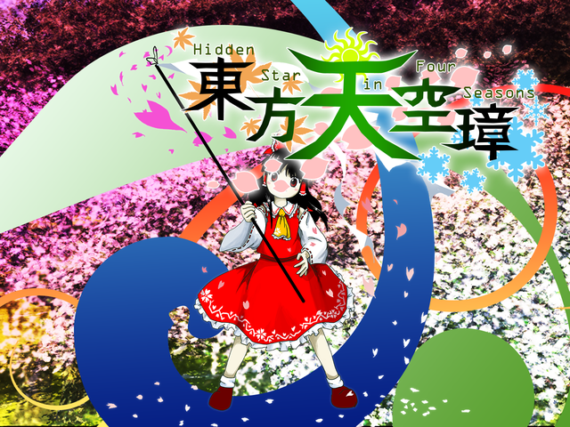
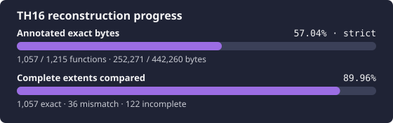

# 東方天空璋 ～ Hidden Star in Four Seasons

Agent workflow: follow the highest-priority requirements in [AGENTS.md](AGENTS.md). Use incremental builds and focused complete-owner comparisons; prose edits need no build or audit.

<p align="center">
  
</p>

<p align="center">
  
</p>

This project reconstructs C++ source for the original Japanese TH16 version
1.00a executable. The source is built with the historical MSVC 2017 (v141_xp)
toolchain under whole-program optimization (/GL, /LTCG). The intended
strict comparison covers complete owned extents and relocations, but the
current candidate has not received fresh Factory-accepted Oracle results.
Similarity scores and upstream labels grant no exact credit.

## Exact target

Supply your own legal copy at the ignored path `resources/th16.exe`.

| Property | Required value |
| --- | --- |
| Version | original Japanese 1.00a |
| Size | `683,520` bytes |
| SHA-256 | `c11776019f083978e66027e7394dafb1fb9543afca986f28049a49417e341929` |
| MD5 | `cb9caf54ce5738f70086e783ec88fd2a` |
| Image base | `0x00400000` |
| Entry point | `0x0047537B` |

The pinned [thcrap version database](https://github.com/thpatch/thcrap-tsa/blob/25acfe37f0bed5008eb8b94afc3d72679fd50384/base_tsa/versions.js)
classifies this exact SHA-256 as `th16`, `v1.00a`, `(original)`; the Steam
release and patched executables have different digests.

```bash
scripts/repo-python scripts/verify-target.py
```

Original executables, game data, Ghidra projects, decompiler output, build
outputs and downloaded tools are private and never committed. The title image
above is composited from the game's own textures for identification only.

## Current status

The **latest saved local strict-audit snapshot** is from **2026-11-15
06:37 UTC**: **1,033 exact / 51 mismatch / 131 incomplete** among 1,215
historical annotated units. The progress image above is historical, not
current accepted exactness. The latest checked **incremental** candidate
build (handoff verification on 2026-11-20) compiles **1,166 annotated
functions**, which is a build count, not an exactness total.

At the latest *source* checkpoint `b814004`, focused normalized
disassembly comparison reports `EnemyData::ecl_run_over_300` **0.8655**
(4,562 / 5,465 target/candidate instructions) and `AnmVm::run`
**0.9531** (3,837 / 3,818). These numbers are not strict Oracle
receipts or a project-wide progress metric. See the
[current handoff](docs/NEXT_AGENT.md) for other large owners and current leads.

The last recorded Factory inventory had zero imported Oracle results;
a fresh accepted-snapshot query on 2026-11-20 was blocked by an
unsupported Windows toolchain-family classification. Current accepted
byte/relocation exactness and production closure therefore remain
**unverified**. The earlier focused Oracle attempt was also blocked at
EH-parent PDB owner preflight. Neither problem is resolved by a successful
build or a normalized instruction ratio. Do not publish updated project-wide
strict totals without a freshly accepted complete-owner receipt.

For a new agent, read [AGENTS.md](AGENTS.md), then the
[short handoff](docs/NEXT_AGENT.md) (current leads, measurements and commands)
and the [knowledge index](docs/knowledge/README.md). The long
[2026-11-19 chronology](docs/HANDOFF_20261119.md) is preserved as history.
The 2026-11-20 handoff archived 63 recoverable duplicate historical
PDB/audit files, reclaiming about 273 MiB without touching the active build;
see [storage recovery](docs/ARTIFACTS.md).

Use `scripts/repo-python`; it selects an interpreter with the hash-pinned
Capstone decoder from `config/tools.lock.toml`.

```bash
scripts/repo-python scripts/build.py                     # incremental LTCG build
scripts/repo-python scripts/audit-reference.py --write-units  # after the strict preflight is resolved
scripts/repo-python scripts/check-frontier.py            # no function may lose ground
scripts/repo-python scripts/progress.py --svg resources/progress.svg
scripts/repo-python scripts/run-tests.py                 # tooling controls, about 2 min
```

Incremental builds reuse objects by their source, included-header and compiler
flag hashes, then perform a full LTCG link. Use `--clean` for a milestone or a
demonstrated cache/dependency problem. Exact credit comes only from the strict
comparison of a complete owner (`scripts/strict_oracle.py`, units in
`config/match-units.toml`); `config/frontiers.toml` records the residual bytes
of every function that is not exact yet.

The selected historical tools are MSVC **19.10.25017**, linker
**14.10.25017.0**, Windows **7.1A** SDK, UCRT **10.0.10240.0** and DirectX SDK
**June 2010**. Ghidra **12.1.3**, Temurin JDK **21.0.12.1+1** and Wine are
provided by the shared Touhou Reconstruction Factory launcher; see
[shared tools](docs/SHARED_TOOLS.md) and [setup evidence](docs/BOOTSTRAP.md).

## Project map

- [`AGENTS.md`](AGENTS.md) — mandatory session and evidence rules.
- [`src/`](src) — reconstructed game source; [`src/decomp.h`](src/decomp.h)
  holds the clearly marked compiler-context placeholders.
- [`probes/`](probes) — toolchain smoke inputs, compiler-context callers and
  opaque support kept outside the game source.
- [`config/target.toml`](config/target.toml) — target identity and PE facts.
- [`config/tools.lock.toml`](config/tools.lock.toml) — compiler, linker, SDK,
  analyzer and linked-code decoder lock.
- [`config/match-units.toml`](config/match-units.toml) — retained strict
  comparison units; [`config/frontiers.toml`](config/frontiers.toml) — the
  non-exact ratchet.
- [`docs/NEXT_AGENT.md`](docs/NEXT_AGENT.md) — current handoff.
- [`docs/REFERENCE_IMPORT.md`](docs/REFERENCE_IMPORT.md) — comparison scope and
  the reference import.
- [`docs/knowledge/`](docs/knowledge/README.md) — evidence cited by the Oracle
  review profiles and the source.
- [`docs/ARTIFACTS.md`](docs/ARTIFACTS.md) — private inputs, retained evidence
  and cleanup policy.

## Credits

This project imports candidate C++ source, names, structures, build-context
harnesses and historical toolchain research from
[johnthreekay/th16](https://github.com/johnthreekay/th16), pinned to commit
`2b846da735ac71f68b1dc74e8194c8c8d98e2869`. Credit belongs to johnthreekay and
the upstream contributors. Their original project work is dedicated under
[CC0 1.0](docs/licenses/johnthreekay-th16-CC0.txt). The game, its data and strings
remain the work of ZUN / Team Shanghai Alice; upstream also identifies its
`DSUtil.cpp` as an adaptation of a Microsoft DirectX SDK sample.

Our strict PE/MAP/PDB readers and Oracle method derive from the MIT-licensed
[TH10 reconstruction](https://github.com/N0zoM1z0/th10) and the Touhou
Reconstruction Factory series. The upstream comparison scripts are not used by
the strict Oracle.

## License

Repository-authored code and documentation are provided under the MIT License.
This does not grant rights to the original game or its assets.
